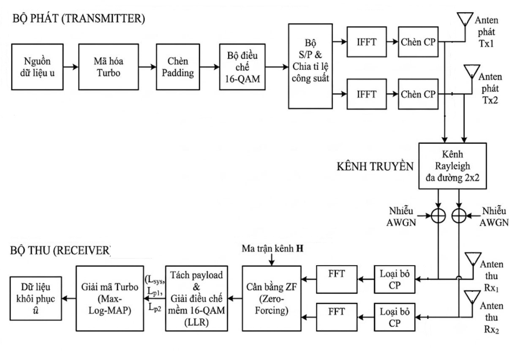
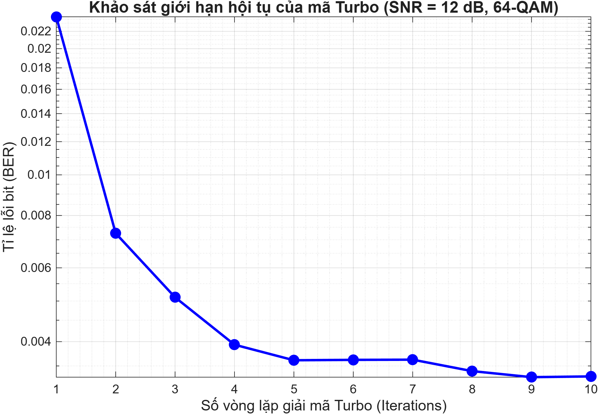
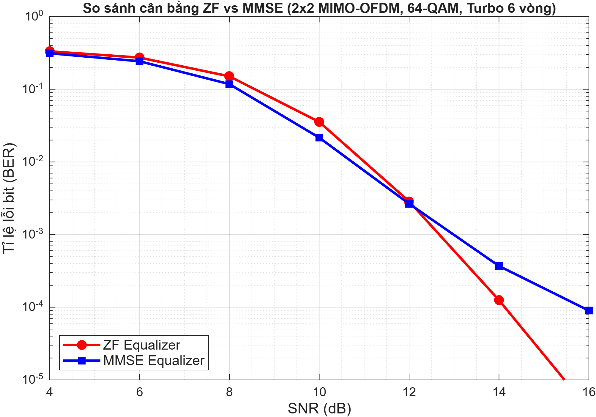

# Đồ án I: Mô phỏng hệ thống 2x2 MIMO-OFDM sử dụng mã Turbo và điều chế 64-QAM

## 1. Mục tiêu

Mục tiêu của đồ án là nghiên cứu, thiết kế và mô phỏng đánh giá hiệu năng hệ thống 2×2 MIMO-OFDM kết hợp kỹ thuật mã hóa kênh Turbo và điều chế bậc cao 64-QAM trên kênh truyền fading Rayleigh đa đường. Đồ án tập trung giải quyết các bài toán trọng tâm:
- Khảo sát hiệu năng sửa lỗi của mã Turbo qua các mức SNR khác nhau so với hệ thống không mã hóa.
- Thực nghiệm tìm kiếm **giới hạn hội tụ tối ưu** của số vòng lặp giải mã Turbo.
- Đánh giá và so sánh hiệu năng giữa hai kỹ thuật tách tín hiệu / cân bằng MIMO: **Zero-Forcing (ZF)** và **Minimum Mean Square Error (MMSE)**.

---

## 2. Sơ đồ hệ thống

Sơ đồ khối tổng quát của hệ thống 2×2 MIMO-OFDM:

*Hình 1. Sơ đồ khối hệ thống MIMO-OFDM 2×2 sử dụng điều chế 64-QAM, mã Turbo và cân bằng ZF/MMSE.*

---

## 3. Mô hình hệ thống

Hệ thống mô phỏng gồm hai anten phát và hai anten thu ($2\times 2$ MIMO), kết hợp với kỹ thuật ghép kênh phân chia theo tần số trực giao (OFDM) với $N = 64$ sóng mang con.

1. **Phát tín hiệu:**
   - Chuỗi bit thông tin được mã hóa Turbo rate $\approx 1/3$.
   - Dữ liệu được điều chế **64-QAM** theo mã Gray (6 bit/symbol) với hệ số chuẩn hóa công suất trung bình bằng 1 là $1/\sqrt{42}$.
   - Tín hiệu được chuyển sang miền thời gian qua biến đổi IFFT 64 điểm và chèn tiền tố chu kỳ (CP) dài 16 mẫu trước khi truyền qua anten phát.

2. **Kênh truyền:**
   - Kênh truyền giữa mỗi cặp anten phát - thu là kênh Rayleigh đa đường chọn lọc tần số gồm $L = 10$ tap độc lập, công suất chuẩn hóa.
   - Nhiễu cộng Gaussian trắng (AWGN) phức được cộng vào tín hiệu thu theo mức SNR khảo sát.

3. **Thu tín hiệu và Cân bằng:**
   - Sau khi loại bỏ CP và biến đổi FFT 64 điểm, tín hiệu trên từng sóng mang con thứ $k$ được biểu diễn:
     $$\mathbf{y}[k] = \mathbf{H}[k]\mathbf{x}[k] + \mathbf{n}[k]$$
   - Bộ thu giả định biết chính xác ma trận kênh (CSI hoàn hảo) và áp dụng một trong hai kỹ thuật cân bằng trên từng sóng mang con:
     - **Cân bằng Zero-Forcing (ZF):** 
       $$\mathbf{W}_{\text{ZF}}[k] = (\mathbf{H}^H[k]\mathbf{H}[k])^{-1}\mathbf{H}^H[k]$$
     - **Cân bằng MMSE:** 
       $$\mathbf{W}_{\text{MMSE}}[k] = \left(\mathbf{H}^H[k]\mathbf{H}[k] + \frac{1}{\text{SNR}}\mathbf{I}\right)^{-1}\mathbf{H}^H[k]$$
   - Tín hiệu sau cân bằng được tính toán phương sai nhiễu tương đương và đưa vào bộ giải điều chế mềm tính Soft-LLR Max-Log cho 64 điểm chòm sao trước khi giải mã Turbo lặp.

---

## 4. Mã hóa và Giải mã Turbo

### 4.1. Bộ mã hóa Turbo (RSC 13/15)
Bộ mã hóa gồm hai bộ mã tích chập đệ quy hệ thống (RSC) giống nhau với đa thức sinh $(13, 15)_8$ và bộ nhớ 3 (8 trạng thái):
- Bộ mã thứ nhất mã hóa trực tiếp chuỗi bit thông tin gốc $u$.
- Bộ mã thứ hai mã hóa chuỗi bit sau khi qua bộ đan xen ngẫu nhiên (Interleaver $\pi$).
- Đầu ra gồm chuỗi bit hệ thống và hai chuỗi parity, cho tốc độ mã $R \approx 1/3$. Với $K_{\text{info}} = 256$ bit, bộ mã tạo ra đúng $256 \times 3 = 768$ bit mã hóa. Số bit này vừa khít $100\%$ dung lượng của một ký hiệu OFDM trên 2 anten ($64 \times 2 \times 6 = 768$ bit), không cần chèn thêm bit 0 padding.

### 4.2. Bộ giải mã Turbo (Max-Log-MAP BCJR)
- Bộ giải mã lặp dựa trên thuật toán BCJR dạng Max-Log-MAP, quy ước dấu LLR:
  $$L(b) = \ln \frac{P(b=0 \mid y)}{P(b=1 \mid y)}$$
- Hai decoder trao đổi thông tin ngoại lai (Extrinsic Information $L_e = L_{\text{post}} - L_{\text{sys}} - L_a$) qua từng vòng lặp để cập nhật độ tin cậy tiên nghiệm cho nhau.
- Quyết định cứng sau vòng lặp cuối cùng được tính: $\hat{u} = (L_{\text{final}} < 0)$.

---

## 5. Tham số mô phỏng

Toàn bộ tham số hệ thống được khai báo tập trung trong [`config_params.m`](config_params.m):

| Tham số | Giá trị | Ý nghĩa |
|---|---:|---|
| Số anten phát / thu ($n_{\text{Tx}} \times n_{\text{Rx}}$) | $2 \times 2$ | Cấu hình MIMO không gian |
| Số sóng mang con OFDM ($N$) | 64 | Kích thước biến đổi FFT / IFFT |
| Độ dài tiền tố chu kỳ ($\text{CP}$) | 16 | Ngăn ngừa nhiễu xuyên ký hiệu (ISI) |
| Số tap kênh Rayleigh ($L$) | 10 | Độ dài kênh chọn lọc tần số ($L \le \text{CP}$) |
| Bậc điều chế ($M$) | 64 | 64-QAM (6 bit/symbol) |
| Chuẩn hóa công suất | $1/\sqrt{42}$ | Chuẩn hóa năng lượng ký hiệu 64-QAM |
| Số bit thông tin mỗi khung ($K_{\text{info}}$) | 256 | Số bit đầu vào bộ mã Turbo |
| Số bit mã hóa mỗi khung ($N_{\text{coded}}$) | 768 | Vừa khít dung lượng 1 frame OFDM |
| Dải SNR khảo sát | 4:2:24 dB | Bước nhảy 2 dB |
| Số khung mô phỏng mỗi mức SNR ($N_{\text{sym}}$) | 2000 | Tương đương $> 512.000$ bit/mức SNR |
| Seed ngẫu nhiên | 2026 | Tái lập chính xác kết quả mô phỏng |

---

## 6. Cấu trúc chương trình

Dự án được tổ chức theo kiến trúc phân tầng (Modular Design):

| File / Thư mục | Chức năng |
|---|---|
| [`main.m`](main.m) | Điểm chạy chính: nạp cấu hình, chạy sweep SNR và vẽ đồ thị BER. |
| [`config_params.m`](config_params.m) | Khai báo toàn bộ tham số mô phỏng hệ thống. |
| [`simulate_frame.m`](simulate_frame.m) | Xử lý một khung truyền nhận: phát 64-QAM $\to$ OFDM $\to$ Kênh $\to$ ZF/MMSE $\to$ Turbo decode. |
| [`turbo_stage.m`](turbo_stage.m) | Mã hóa Turbo rate 1/3 và giải mã lặp BCJR Max-Log-MAP. |
| [`qam16_stage.m`](qam16_stage.m) | Điều chế 64-QAM Gray mapping và tính Soft-LLR Max-Log 64 điểm. |
| [`mimo_zf_stage.m`](mimo_zf_stage.m) | Cân bằng MIMO đa sóng mang hỗ trợ cả **ZF** và **MMSE**. |
| [`ofdm_stage.m`](ofdm_stage.m) | Biến đổi IFFT/FFT và thêm/bỏ tiền tố chu kỳ CP. |
| [`channel_stage.m`](channel_stage.m) | Kênh fading Rayleigh 10 tap đa đường và cộng nhiễu AWGN. |
| [`analysis_stage.m`](analysis_stage.m) | Tính đường lý thuyết giải tích ZF 64-QAM và vẽ đồ thị BER. |
| [`tim_gioi_han_vong_lap.m`](tim_gioi_han_vong_lap.m) | Script khảo sát tìm giới hạn hội tụ của số vòng lặp Turbo (1 - 10 vòng). |
| [`so_sanh_zf_mmse.m`](so_sanh_zf_mmse.m) | Script mô phỏng so sánh trực tiếp hiệu năng giữa ZF và MMSE. |
| `docs/images/` | Chứa sơ đồ khối hệ thống và các đồ thị kết quả mô phỏng. |

---

## 7. Kết quả mô phỏng và Đánh giá

### 7.1. Khảo sát giới hạn hội tụ của số vòng lặp giải mã Turbo

Để xác định số vòng lặp giải mã tối ưu nhằm cân bằng giữa hiệu năng BER và độ trễ tính toán, hệ thống được khảo sát từ **1 đến 10 vòng lặp** tại mức $\text{SNR} = 12\text{ dB}$ (vùng thác đổ):

*Hình 2. Đồ thị khảo sát BER theo số vòng lặp giải mã Turbo tại SNR = 12 dB (64-QAM).*

**Nhận xét:**
- **Từ vòng 1 đến vòng 4:** BER giảm rất dốc (từ $2.25\%$ ở vòng 1 rơi xuống $0.39\%$ ở vòng 4 — giảm gần 6 lần). Đây là giai đoạn các decoder thành phần trao đổi thông tin ngoại lai hiệu quả nhất.
- **Từ vòng 5–6 trở đi:** Đường BER đi ngang và đạt trạng thái **bão hòa** quanh mức $\approx 0.25\% - 0.3\%$. Tăng lên 8 hay 10 vòng tốn thêm nhiều thời gian tính toán nhưng không giảm thêm lỗi.
- **Kết luận:** **6 vòng lặp** là giới hạn hội tụ tối ưu của bộ giải mã Turbo trong hệ thống này.

---

### 7.2. So sánh hiệu năng cân bằng Zero-Forcing (ZF) và MMSE

So sánh hiệu năng giữa bộ cân bằng ZF và MMSE trên cùng hệ thống 64-QAM, Turbo 6 vòng lặp với 2000 frame:

*Hình 3. So sánh hiệu năng BER giữa bộ cân bằng ZF và MMSE (2×2 MIMO-OFDM, 64-QAM, Turbo 6 vòng).*

**Nhận xét chuyên sâu:**
1. **Ở dải SNR thấp và trung bình (4 – 12 dB):**
   - **MMSE vượt trội hơn hẳn so với ZF**, mang lại độ lợi khoảng $\sim 1\text{ dB}$.
   - Tại $\text{SNR} = 12\text{ dB}$, BER của MMSE ($2.1 \times 10^{-3}$) giảm hơn một nửa so với ZF ($4.7 \times 10^{-3}$).
   - *Nguyên nhân:* ZF cố gắng triệt tiêu hoàn toàn can nhiễu nên bị hiện tượng **khuếch đại nhiễu (noise enhancement)** mạnh khi ma trận kênh bị suy biến sâu. Trong khi đó, MMSE bổ sung thành phần điều hòa $\frac{1}{\text{SNR}}\mathbf{I}$ giúp cân bằng tối ưu giữa việc giảm can nhiễu và hạn chế khuếch đại nhiễu Gaussian.
2. **Ở dải SNR cao (> 13 dB):**
   - Khi công suất nhiễu Gaussian trở nên không đáng kể, can nhiễu giữa các luồng anten trở thành yếu tố chi phối. ZF triệt tiêu sạch $100\%$ can nhiễu đa luồng ($\mathbf{W}_{\text{ZF}}\mathbf{H} = \mathbf{I}$), trong khi MMSE vẫn để lại một lượng can nhiễu dư nhỏ. Do đó, đường ZF dốc sạch lỗi nhanh hơn.
   - Khi $\text{SNR} \to \infty$, thành phần $\frac{1}{\text{SNR}}\mathbf{I} \to 0$, bộ cân bằng MMSE hội tụ hoàn toàn về đáp ứng của ZF.

---

## 8. Hướng phát triển tiếp theo

- **Dạng sóng OTFS (Orthogonal Time Frequency Space):** Nghiên cứu thay thế khối OFDM bằng OTFS trên miền trễ - Doppler (Delay-Doppler) để khắc phục hiện tượng dịch Doppler cao trong các kịch bản di động tốc độ cao.
- **Dạng sóng AFDM (Affine Frequency Division Multiplexing):** Nghiên cứu biến đổi Affine Fourier rời rạc (DAFT) để đạt phân tập tối đa với độ phức tạp thấp.
- **Ước lượng kênh thực tế:** Mở rộng từ giả định kênh hoàn hảo (CSI) sang mô hình ước lượng kênh sử dụng Pilot và nội suy kênh 2D.
