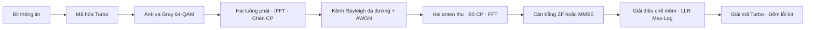
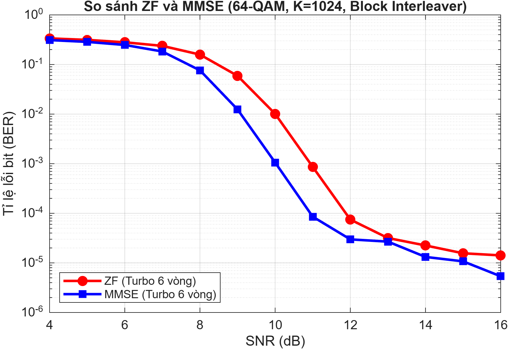

# Đồ án I — Mô phỏng MIMO-OFDM 2×2 với mã Turbo và 64-QAM

Dự án MATLAB mô phỏng truyền hai luồng dữ liệu qua kênh Rayleigh đa đường với nhiễu cộng Gaussian trắng (AWGN). Ba thí nghiệm khảo sát tỉ lệ lỗi bit (BER) theo SNR, mức giảm BER khi tăng số vòng giải mã Turbo và sự khác biệt giữa hai bộ cân bằng Zero-Forcing (ZF) và Minimum Mean Square Error (MMSE).

## Chạy mô phỏng

Dùng **MATLAB R2020a trở lên** để chạy cả ba script, vì hai script khảo sát dùng hàm xuất ảnh từ phiên bản này. Mã nguồn sử dụng các hàm MATLAB cơ bản, không yêu cầu Communications Toolbox. [Tài liệu MathWorks về exportgraphics](https://www.mathworks.com/help/matlab/ref/exportgraphics.html)

Chọn thư mục chứa [main.m](main.m) làm **Current Folder** trong MATLAB. Chạy từng lệnh dưới đây trong Command Window tùy theo thí nghiệm cần thực hiện.

| Lệnh | Cân bằng | SNR | Khung mỗi mức SNR | Số vòng Turbo | Bộ đan xen |
| --- | --- | --- | ---: | --- | --- |
| [main](main.m) | ZF | 5–15 dB, bước 1 dB | 500 | 2, 6, 8 | Hoán vị ngẫu nhiên, seed 2026 |
| [tim_gioi_han_vong_lap](tim_gioi_han_vong_lap.m) | ZF | 12 dB | 2.000 | 1–10 | Hoán vị ngẫu nhiên, seed 2026 |
| [so_sanh_zf_mmse](so_sanh_zf_mmse.m) | ZF và MMSE | 4–16 dB, bước 1 dB | 2.000 cho mỗi bộ cân bằng | 6 | Đan xen khối 32×32, script không đặt seed |

Cả ba lệnh đều in BER ra Command Window và mở đồ thị. Trong Workspace, [main](main.m) trả kết quả qua `results.BER_post` và `results.BER_th`, với hàng tương ứng từng mức SNR và cột của `BER_post` tương ứng từng mốc vòng lặp. Hai script khảo sát lưu kết quả vào `ber_iters` hoặc `ber_zf` và `ber_mmse`. Chúng cũng xuất ảnh lần lượt ra `gioi_han_vong_lap.png` ở thư mục hiện hành và `docs/images/so_sanh_zf_mmse_2000frame.png`. Chạy lại có thể ghi đè ảnh tại các đường dẫn xuất.

Lệnh chạy thử dưới đây dùng 5 khung tại 12 dB để kiểm tra luồng xử lý trước khi chạy toàn bộ dải SNR.

```matlab
cfg = config_params();
cfg.snr_db = 12;
cfg.N_sym = 5;
cfg.iter_list = 2;
cfg.Ntheory = 1000;
results = run_simulation(cfg);
disp(results.BER_post);
```

## Mô hình hệ thống



| Tham số | Giá trị trong mã hiện tại |
| --- | --- |
| Anten phát × anten thu | 2 × 2, hai luồng ghép kênh không gian |
| Sóng mang con / kích thước FFT | 64 |
| Tiền tố chu kỳ (CP) | 16 mẫu |
| Kênh truyền | 10 tap Rayleigh độc lập trên mỗi cặp anten phát–thu, công suất trung bình mỗi tap là $1/10$ |
| Điều chế | 64-QAM Gray, 6 bit/ký hiệu, chuẩn hóa chòm sao bằng $1/\sqrt{42}$ |
| Một khung Turbo | 1.024 bit thông tin → 3.072 bit mã hóa → 512 ký hiệu QAM |
| Dung lượng truyền mỗi khung | 4 ký hiệu OFDM × 64 sóng mang × 2 anten × 6 bit = 3.072 bit. Cấu hình này dùng 0 bit đệm. |

**Mã Turbo.** Hai bộ mã tích chập đệ quy hệ thống (RSC) có 8 trạng thái, với đa thức phản hồi 13 và đa thức tạo parity 15 trong hệ bát phân. Bộ thứ nhất mã hóa chuỗi bit gốc, bộ thứ hai mã hóa chuỗi đã đan xen. Khung mã gồm chuỗi bit hệ thống và hai chuỗi parity, cho tốc độ mã $R = 1/3$ và không có bit kết thúc trellis. Bộ giải mã BCJR dạng Max-Log-MAP trao đổi thông tin ngoại lai giữa hai bộ giải mã thành phần. LLR dương nghiêng về bit 0 và LLR âm nghiêng về bit 1.

**Kênh và quy ước SNR.** Mô phỏng lấy mẫu lại kênh ở mỗi ký hiệu OFDM và giả định bộ thu biết chính xác đáp ứng kênh trên từng sóng mang (CSI hoàn hảo). Tín hiệu phát được chia cho $\sqrt{n_\mathrm{Tx}}$ trước IFFT. Phương sai AWGN phức trong miền thời gian bằng công suất mẫu phát trung bình trên các anten, tính cả CP, chia cho $\rho = 10^{\mathrm{SNR}_{\mathrm{dB}}/10}$. Trục SNR của đồ thị dùng trực tiếp tham số này.

**Cân bằng và giải điều chế.** Với $\mathbf H_k$ là ma trận kênh trên sóng mang $k$, hai bộ cân bằng dùng trọng số sau.

$$
\mathbf W_{\mathrm{ZF},k}=(\mathbf H_k^H\mathbf H_k)^{-1}\mathbf H_k^H
\qquad
\mathbf W_{\mathrm{MMSE},k}=(\mathbf H_k^H\mathbf H_k+\rho^{-1}\mathbf I)^{-1}\mathbf H_k^H
$$

ZF triệt can nhiễu giữa các luồng khi ma trận kênh có hạng đầy đủ, nhưng có thể khuếch đại nhiễu mạnh khi kênh gần suy biến. MMSE dùng hạng tử điều chuẩn $\rho^{-1}\mathbf I$ để hạn chế khuếch đại nhiễu. Nhánh MMSE còn hiệu chỉnh độ lợi của từng luồng và tính cả can nhiễu dư vào phương sai tương đương mà bộ giải điều chế mềm dùng để tính LLR.

## Cách đọc kết quả BER

BER sau giải mã bằng tổng số bit thông tin giải mã sai chia cho tổng số bit thông tin đã truyền. Mỗi điểm SNR của [main](main.m) dùng 512.000 bit thông tin. Phép so sánh ZF/MMSE dùng 2.048.000 bit cho mỗi phương pháp tại mỗi mức SNR. Hai phương pháp dùng cùng cấu hình và bộ đan xen, với các mẫu bit, kênh và nhiễu được sinh riêng cho từng nhánh.

Đường `Uncoded ZF theory` trong đồ thị của [main](main.m) là mốc tham chiếu. Chương trình lấy trung bình công thức BER xấp xỉ của 64-QAM trên 200.000 mẫu ma trận kênh Rayleigh 2×2. Các đường Turbo được tính từ lỗi bit đo trực tiếp qua chuỗi mô phỏng theo khung.

### Số vòng giải mã Turbo


*Hình 1. Kết quả lưu từ cấu hình ban đầu với khung 256 bit. Script khảo sát hiện dùng khung 1.024 bit.*

BER giảm từ khoảng 2,25% ở vòng 1 xuống 0,39% ở vòng 4, rồi giảm chậm hơn. Phép so sánh ZF/MMSE đặt cố định 6 vòng cho cả hai bộ cân bằng. Có thể đo lại đường BER theo số vòng lặp cho khung 1.024 bit bằng [tim_gioi_han_vong_lap](tim_gioi_han_vong_lap.m).

### So sánh ZF và MMSE



*Hình 2. Kết quả đã lưu cho 64-QAM, khung Turbo 1.024 bit, bộ đan xen khối 32×32 và 6 vòng giải mã.*

Trong lần chạy được minh họa, MMSE cho BER thấp hơn ZF tại cả 13 mức SNR. Tại 11 dB, BER của MMSE khoảng $8{,}5\times10^{-5}$, thấp hơn khoảng 10 lần so với ZF ($8{,}6\times10^{-4}$). BER giảm mạnh trong khoảng 8–12 dB, tương ứng với vùng *waterfall*. Ở 16 dB, BER đã xuống mức khoảng $10^{-5}$, tương ứng với số bit lỗi ít trên 2.048.000 bit. Cần thêm số liệu ở vùng SNR cao để xác định có sàn lỗi (*error floor*) hay không.

## Cấu trúc mã nguồn

| Tệp | Vai trò |
| --- | --- |
| [main.m](main.m) | Nạp cấu hình, chạy mô phỏng theo SNR và vẽ BER. |
| [config_params.m](config_params.m) | Khai báo tham số mặc định và tính dung lượng khung, số bit mã hóa, bit đệm. |
| [run_simulation.m](run_simulation.m) | Khởi tạo seed và bộ đan xen, chạy các khung ZF và tổng hợp BER theo SNR. |
| [simulate_frame.m](simulate_frame.m) | Điều phối chuỗi phát–thu cho một khung Turbo và đếm lỗi tại từng mốc vòng lặp. |
| [turbo_stage.m](turbo_stage.m) | Mã hóa RSC và giải mã Turbo bằng BCJR Max-Log-MAP. |
| [qam16_stage.m](qam16_stage.m) | Ánh xạ Gray và tính LLR cho 64-QAM. Tên tệp được giữ từ phiên bản 16-QAM. |
| [ofdm_stage.m](ofdm_stage.m) | IFFT, FFT và chèn hoặc bỏ tiền tố chu kỳ. |
| [channel_stage.m](channel_stage.m) | Sinh kênh Rayleigh, chập tín hiệu theo từng cặp anten và cộng AWGN. |
| [mimo_zf_stage.m](mimo_zf_stage.m) | Cân bằng ZF hoặc MMSE theo sóng mang và tính hệ số dùng cho phương sai nhiễu tương đương. |
| [analysis_stage.m](analysis_stage.m) | Tính BER tham chiếu cho ZF không mã hóa và vẽ đồ thị của chương trình chính. |
| [tim_gioi_han_vong_lap.m](tim_gioi_han_vong_lap.m) | Đo BER theo số vòng giải mã tại SNR cố định. |
| [so_sanh_zf_mmse.m](so_sanh_zf_mmse.m) | So sánh BER giữa hai phương pháp cân bằng. |
| [docs/images/](docs/images/) | Chứa các hình minh họa và kết quả mô phỏng đã lưu. |

Khi tùy chỉnh phép chạy, có thể đặt lại `cfg.snr_db`, `cfg.N_sym` và `cfg.iter_list` sau khi gọi `config_params()`. Đồ thị của chương trình chính có sẵn ba kiểu đường cho tối đa ba mốc vòng lặp. Hai script khảo sát tự đặt lại các tham số tương ứng như trong bảng lệnh. Mô hình hiện được triển khai cho MIMO 2×2 và 64-QAM. Khi đổi độ dài khung, cần cập nhật các tham số dẫn xuất trong [config_params.m](config_params.m) và kích thước bộ đan xen khối trong [so_sanh_zf_mmse.m](so_sanh_zf_mmse.m).

## Hướng phát triển

- Khảo sát các dạng sóng OTFS và AFDM trong kênh có dịch Doppler.
- Bổ sung pilot và nội suy theo thời gian–tần số để đánh giá ảnh hưởng của sai số ước lượng kênh.
