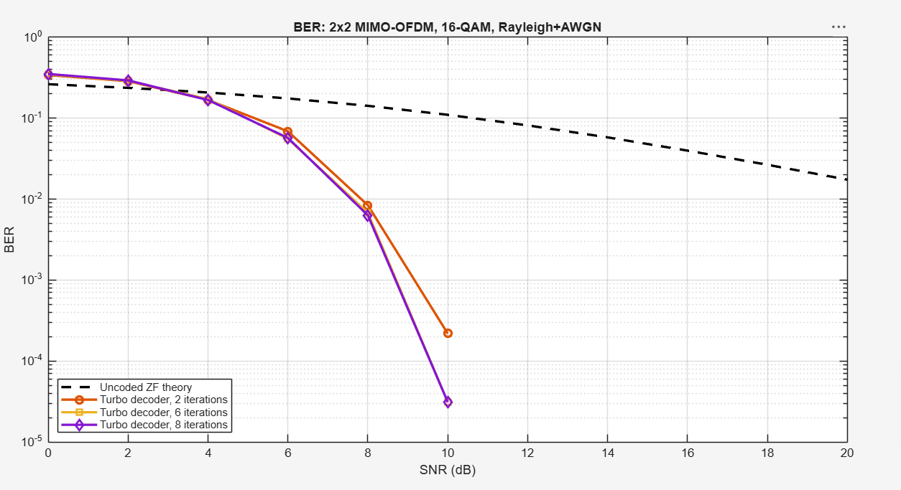

# Đồ án I: Mô phỏng hệ thống 2x2 MIMO-OFDM sử dụng mã Turbo

## 1. Mục tiêu

Mục tiêu của đồ án là khảo sát hiệu quả của mã Turbo trong hệ thống 2x2 MIMO-OFDM. Hiệu năng hệ thống được đánh giá qua BER sau giải mã so với hệ thống không mã hóa ở các mức SNR khác nhau.

## 2. Sơ đồ hệ thống

Sơ đồ khối tổng quát của hệ thống MIMO-OFDM được trình bày dưới đây.

*Hình 1. Sơ đồ khối hệ thống MIMO-OFDM 2×2 sử dụng điều chế 16-QAM và mã Turbo.*

## 3. Mô hình hệ thống

Hệ thống mô phỏng sử dụng hai anten phát và hai anten thu (MIMO 2×2), kết hợp với OFDM gồm 64 sóng mang con. Dữ liệu được điều chế 16-QAM, biến đổi IFFT và gắn tiền tố chu kỳ (CP) dài 16 mẫu trước khi truyền. Kênh giữa mỗi cặp anten phát-thu là kênh Rayleigh đa đường gồm 10 tap độc lập, có công suất trung bình chuẩn hóa; nhiễu cộng Gaussian trắng (AWGN) phức được thêm vào tín hiệu thu theo mức SNR đang khảo sát.

Kênh được giữ cố định trong một frame và tạo lại độc lập giữa các frame. CP dài hơn số tap kênh, nên sau khi bỏ CP và thực hiện FFT, có thể mô hình hóa tín hiệu riêng trên từng sóng mang con. Trên sóng mang con thứ $k$, mô hình tín hiệu là $\mathbf{y}[k]=\mathbf{H}[k]\mathbf{x}[k]+\mathbf{n}[k]$, trong đó $\mathbf{x}[k]$ là vector tín hiệu phát, $\mathbf{H}[k]$ là ma trận kênh, và $\mathbf{n}[k]$ là vector nhiễu.

Trong chương trình, SNR được đặt theo tỉ số công suất tín hiệu mẫu ở đầu vào kênh trên công suất AWGN phức ở đầu vào kênh: $\mathrm{SNR}=P_{signal}/P_{noise}$. Giá trị dB được đổi sang tuyến tính trước khi tạo nhiễu. Sau FFT và cân bằng ZF, phương sai nhiễu được tính theo từng luồng và từng sóng mang con để tạo LLR cho giải mã mềm. Đường BER tham chiếu dùng cùng quy ước SNR đầu vào; $\gamma$ trong xấp xỉ BER 16-QAM là SNR ký hiệu sau ZF.

Bộ thu được giả định biết chính xác ma trận kênh (CSI hoàn hảo) và dùng cân bằng Zero-Forcing (ZF) trên từng sóng mang con để ước lượng tín hiệu phát: $\hat{\mathbf{x}}[k]=(\mathbf{H}^{H}[k]\mathbf{H}[k])^{-1}\mathbf{H}^{H}[k]\mathbf{y}[k]$. Tín hiệu ước lượng sau đó được giải điều chế mềm và đưa vào bộ giải mã Turbo.

## 4. Mã hóa và giải mã Turbo

### 4.1. Mã hóa Turbo

Bộ mã hóa gồm hai bộ mã tích chập đệ quy hệ thống (RSC), dùng đa thức sinh $(13,15)_8$ và bộ nhớ 3. Mỗi bộ cập nhật thanh ghi trạng thái và tính bit parity bằng các phép XOR trên bit. Bộ thứ nhất xử lý chuỗi bit thông tin theo thứ tự ban đầu; bộ thứ hai xử lý cùng chuỗi sau khi đan xen.

Đầu ra gồm chuỗi bit thông tin gốc (bit hệ thống) và hai chuỗi parity, nên tốc độ mã xấp xỉ 1/3. Với 160 bit thông tin mỗi frame, bộ mã tạo 480 bit mã hóa. Sau đó chương trình thêm 32 bit 0 để lấp đầy dung lượng 512 bit của một symbol OFDM trên hai anten. Padding chỉ dùng để lấp frame, không đi qua bộ mã Turbo. Bộ mã cũng không thêm tail bits để đưa trạng thái trellis về trạng thái kết thúc.

### 4.2. Giải mã Turbo

Bộ giải điều chế 16-QAM cung cấp LLR mềm: với mỗi bit, giá trị LLR biểu thị mức độ tin cậy rằng bit bằng 0 hay 1. Bộ giải mã Turbo dùng hai decoder thành phần BCJR, mỗi decoder xử lý một chuỗi parity cùng thông tin hệ thống theo thứ tự tương ứng. Khác với mã hóa bằng XOR, giải mã phải suy ra chuỗi bit phù hợp nhất với các quan sát nhiễu và các chuyển trạng thái hợp lệ của encoder.

Mỗi decoder xét trellis gồm 8 trạng thái có thể có của thanh ghi. BCJR tính điểm cho các đường đi qua trellis bằng cách kết hợp thông tin nhận được với quy tắc chuyển trạng thái của bộ mã. Phiên bản Max-Log-MAP xấp xỉ phép tính tổng trên các đường đi bằng cách chỉ giữ đường có điểm lớn nhất. Từ các điểm này, decoder tạo LLR hậu nghiệm cho từng bit rồi trừ đi thông tin hệ thống và thông tin tiên nghiệm đã nhận; phần còn lại gọi là thông tin ngoại lai (extrinsic information), tức thông tin mới rút ra từ parity và cấu trúc trellis.

Hai decoder trao đổi thông tin ngoại lai lặp đi lặp lại: decoder thứ nhất xử lý thứ tự ban đầu, thông tin của nó được đan xen để decoder thứ hai xử lý thứ tự đã đan xen; thông tin trả về được giải đan xen rồi đưa lại cho decoder thứ nhất. Mô phỏng đo BER sau 2, 6 và 8 vòng lặp, với quyết định bit từ LLR kết hợp cuối cùng. Vì encoder không phát tail bits, decoder không giả định một trạng thái trellis kết thúc cố định.

## 5. Tham số mô phỏng

Các giá trị mặc định được khai báo trong `config_params.m`.

| Tham số | Giá trị mặc định | Ý nghĩa |
|---|---:|---|
| Số anten phát, $n_{Tx}$ | 2 | Số luồng phát MIMO |
| Số anten thu, $n_{Rx}$ | 2 | Số luồng thu MIMO |
| Số sóng mang con, $N$ | 64 | Kích thước FFT/IFFT của OFDM |
| Độ dài CP | 16 mẫu | Tiền tố chu kỳ cho mỗi symbol OFDM |
| Số tap kênh, $L$ | 10 | Số tap của kênh Rayleigh đa đường |
| Điều chế, $M$ | 16 | 16-QAM, tương đương 4 bit trên mỗi symbol |
| Bit thông tin mỗi frame, $K_{info}$ | 160 | Số bit đầu vào bộ mã Turbo |
| Số vòng giải mã Turbo | 2, 6, 8 | Các số vòng được so sánh |
| Số frame mỗi mức SNR | 200 | Số frame dùng để tính BER mô phỏng |
| Dải SNR | 0:2:20 dB | Các mức SNR từ 0 đến 20 dB, bước 2 dB |
| Số mẫu kênh tham chiếu, $N_{theory}$ | 200.000 | Số mẫu dùng tính đường tham chiếu lý thuyết |
| Seed ngẫu nhiên | 2026 | Giúp tái lập chuỗi ngẫu nhiên của mô phỏng |

Mỗi symbol OFDM trên hai anten có sức chứa $64\times2\times4=512$ bit. Trong đó, 480 bit là đầu ra mã Turbo và 32 bit còn lại là padding. Chương trình kiểm tra các điều kiện kích thước như CP không dài hơn FFT, số tap kênh không vượt quá độ dài CP, và số bit mã hóa không vượt sức chứa symbol OFDM.

## 6. Phương pháp đánh giá

Chỉ số chính là BER sau giải mã Turbo. Với mỗi mức SNR, bộ thu so sánh các bit thông tin sau giải mã với các bit thông tin đã phát, rồi chia tổng số bit sai cho tổng số bit đã phát:

$$\mathrm{BER}_{post}=\frac{\text{số bit thông tin giải mã sai}}{\text{tổng số bit thông tin đã phát}}.$$

Mô phỏng chạy 200 frame tại mỗi mức SNR; mỗi frame có 160 bit thông tin, tương đương 32.000 bit được đánh giá cho một điểm SNR. BER sau giải mã được so sánh với đường tham chiếu lý thuyết của hệ thống 16-QAM không mã hóa dùng ZF trên kênh Rayleigh 2×2. Đường tham chiếu được tính bằng xấp xỉ lý thuyết và lấy trung bình trên 200.000 mẫu kênh.

Chương trình hiện ghi BER lý thuyết tham chiếu và BER sau giải mã Turbo cho từng số vòng lặp. Với 200 frame và 160 bit thông tin mỗi frame, mỗi điểm BER sau giải mã dựa trên 32.000 bit thông tin.

## 7. Cấu trúc chương trình

| File | Chức năng |
|---|---|
| `main.m` | Điểm bắt đầu: nạp cấu hình, chạy mô phỏng và vẽ biểu đồ. |
| `config_params.m` | Khai báo tham số mặc định và kiểm tra các điều kiện kích thước. |
| `run_simulation.m` | Quét các mức SNR, chạy nhiều frame và tổng hợp BER theo số vòng Turbo. |
| `simulate_frame.m` | Thực hiện một frame từ sinh bit, truyền qua kênh, thu nhận đến giải mã và đếm lỗi. |
| `turbo_stage.m` | Mã hóa Turbo và giải mã lặp Max-Log-MAP BCJR. |
| `qam16_stage.m` | Điều chế 16-QAM, quyết định cứng và tính LLR mềm. |
| `ofdm_stage.m` | Thực hiện IFFT/FFT và thêm/bỏ tiền tố chu kỳ. |
| `channel_stage.m` | Mô phỏng kênh Rayleigh đa đường và nhiễu AWGN. |
| `mimo_zf_stage.m` | Cân bằng Zero-Forcing trên từng sóng mang con. |
| `analysis_stage.m` | Tính đường BER tham chiếu và vẽ biểu đồ BER. |
| `docs/images/turbo.jpg` | Sơ đồ khối hệ thống dùng trong README. |
| `docs/images/ket_qua.png` | Biểu đồ BER với các mức lặp Turbo. |

Luồng chạy bắt đầu từ `main.m`, sau đó `run_simulation.m` gọi `simulate_frame.m` cho từng frame và mức SNR. Các khối điều chế, OFDM, kênh, cân bằng và Turbo được thực hiện bởi các file stage tương ứng.

## 8. Cách chạy mô phỏng

### MATLAB Desktop

1. Mở MATLAB và đặt thư mục `github_modular` làm Current Folder.
2. Mở `main.m` hoặc nhập `main` vào Command Window.
3. Chờ chương trình chạy hết các mức SNR. BER tham chiếu và BER sau giải mã với 2, 6, 8 vòng lặp sẽ được in trong Command Window; sau đó chương trình mở biểu đồ BER.

### MATLAB Online

1. Tải thư mục project lên MATLAB Drive.
2. Mở thư mục project trong MATLAB Online để đặt nó làm thư mục hiện tại.
3. Mở `main.m` và nhấn **Run**, hoặc nhập `main` vào Command Window.

Giữ các file `.m` cùng thư mục để MATLAB tìm thấy các hàm mô phỏng.

## 9. Kết quả

Biểu đồ dưới đây so sánh BER tham chiếu của ZF không mã hóa với BER sau giải mã Turbo tại 2, 6 và 8 vòng lặp.

