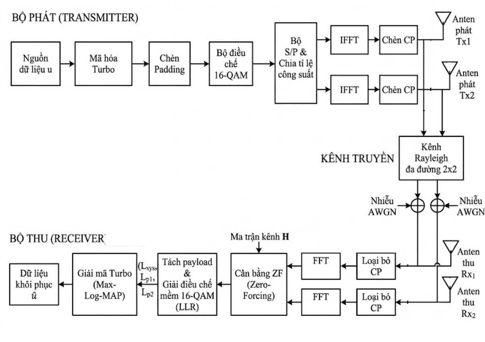

# Đồ án I: Mô phỏng hệ thống 2×2 MIMO-OFDM dùng 16-QAM và mã Turbo

## 1. Mục tiêu

Mô phỏng một liên kết truyền thông số 2×2 MIMO-OFDM qua kênh Rayleigh đa đường có nhiễu AWGN. Bộ thu dùng cân bằng Zero-Forcing (ZF); hiệu quả được đánh giá qua BER và SER trước/sau giải mã Turbo theo SNR. Đường tham chiếu lý thuyết mô tả hệ thống 16-QAM không mã hóa với ZF trên kênh Rayleigh 2×2.

## 2. Cấu trúc frame

Cấu hình mặc định dùng 160 bit thông tin cho mỗi frame. Bộ mã Turbo tự cài đặt tạo 480 bit, gồm bit hệ thống và hai dãy parity (tỷ lệ xấp xỉ 1/3, không thêm bit kết thúc trellis). 32 bit đệm được thêm để tạo đủ 512 bit cho một symbol OFDM trên mỗi anten phát.

Với 16-QAM, 512 bit tạo 128 symbol: 64 subcarrier × 2 anten phát. Trong đó 120 symbol mang bit mã hóa và 8 symbol tương ứng với phần đệm. Mỗi anten phát một symbol OFDM gồm 64 mẫu IFFT và CP dài 16 mẫu, tổng cộng 80 mẫu thời gian.

## 3. Luồng xử lý

Luồng xử lý: sinh bit thông tin và mã hóa Turbo; đệm, điều chế 16-QAM và chia symbol cho hai anten; thực hiện IFFT, chèn CP, truyền qua kênh Rayleigh 10 tap và AWGN. Ở phía thu, bỏ CP trước FFT, cân bằng ZF với giả định biết chính xác đáp ứng kênh, tính LLR và giải mã Turbo. Kết quả BER/SER được tổng hợp qua các frame ở từng mức SNR.

Hình mô tả chuỗi khối phát, kênh truyền và thu. Chương trình thống kê BER/SER trước và sau giải mã theo từng mức SNR; các chỉ số được giải thích ở mục tiếp theo.

## 4. Chỉ số đánh giá

- **BER trước giải mã:** quyết định cứng từ LLR của phần bit hệ thống.
- **BER sau giải mã:** so sánh bit đầu ra Turbo decoder với bit thông tin ban đầu.
- **SER trước giải mã:** so symbol quyết định cứng với các symbol truyền mang bit mã hóa.
- **SER sau giải mã:** giải mã, mã hóa lại, điều chế lại rồi so symbol mã hóa với symbol truyền. Đây là tỷ lệ symbol sai trên luồng mã hóa, không phải SER của bit thông tin chưa mã hóa.
- **Đường tham chiếu:** BER/SER 16-QAM không mã hóa với ZF trên kênh Rayleigh 2×2, lấy trung bình trên 200.000 mẫu kênh và dùng xấp xỉ hàm Q.

## 5. Cấu hình mặc định

| Tham số | Giá trị | Ý nghĩa |
|---|---:|---|
| `N` | 64 | Số subcarrier OFDM |
| `CP` | 16 | Độ dài cyclic prefix |
| `nTx`, `nRx` | 2, 2 | Số anten phát/thu |
| `L` | 10 | Số tap kênh Rayleigh |
| `M` | 16 | Điều chế 16-QAM |
| `K_info` | 160 | Bit thông tin trên mỗi frame |
| `nIter` | 6 | Số vòng lặp giải mã Turbo |
| `N_sym` | 200 | Số frame trên mỗi mức SNR |
| `snr_db` | 0:2:20 dB | Dải SNR mô phỏng |
| `Ntheory` | 200000 | Số mẫu kênh cho đường tham chiếu |
| `seed` | 2026 | Seed để tái lập chuỗi ngẫu nhiên |

Các điều kiện kích thước được kiểm tra trong `config_params.m`: `L <= CP <= N`, số bit mã hóa chia hết cho số bit trên một symbol QAM, và số bit mã hóa không vượt dung lượng frame.

## 6. Các file trong project

- `main.m`: điểm bắt đầu chạy mô phỏng.
- `config_params.m`: khai báo tham số và kiểm tra kích thước cơ bản.
- `run_simulation.m`: tạo interleaver, chạy vòng lặp SNR/frame và tổng hợp BER/SER.
- `simulate_frame.m`: kết nối các khối phát, kênh, thu và thống kê một frame.
- `channel_stage.m`: mô hình kênh Rayleigh đa đường và AWGN.
- `ofdm_stage.m`: IFFT/FFT và chèn/bỏ CP.
- `mimo_zf_stage.m`: cân bằng ZF và ước lượng mức khuếch đại nhiễu.
- `turbo_stage.m`: mã hóa/giải mã Turbo cùng các hàm phụ RSC, BCJR và trellis.
- `qam16_stage.m`: điều chế, quyết định cứng và giải điều chế LLR 16-QAM.
- `analysis_stage.m`: tính đường tham chiếu và vẽ biểu đồ BER/SER.

## 7. Cách chạy

### MATLAB Desktop

Mở thư mục project làm Current Folder, sau đó chạy `main.m`.

### MATLAB Online

Tải thư mục project lên MATLAB Drive, mở thư mục đó trong bảng Files và chạy `main.m`. Các file `.m` nên nằm cùng một thư mục; không cần Communications Toolbox cho bộ điều chế và bộ mã hóa/giải mã tự cài đặt này.

## 8. Tinh chỉnh và giới hạn mô hình

- Tăng `N_sym` để cải thiện độ tin cậy thống kê của BER/SER; thời gian chạy sẽ tăng.
- Thay đổi `nIter` để khảo sát quan hệ giữa số vòng Turbo, BER và thời gian xử lý.
- Thay đổi `snr_db` để điều chỉnh dải điểm trên biểu đồ.
- Khi thay đổi `L`, bảo đảm CP đủ dài (`L <= CP`). Khi thay đổi `K_info`, kiểm tra lại điều kiện chia hết theo 4 bit/symbol và dung lượng frame.
- Kênh được giữ cố định trong một frame và thay đổi giữa các frame. Mô hình chưa có pilot, ước lượng kênh, sai lệch đồng bộ, Doppler hay bộ cân bằng MMSE.
- Bộ mã Turbo không thêm bit kết thúc trellis; đây là cấu hình đơn giản hóa để phục vụ mô phỏng.
- Mỗi điểm BER dùng số frame hữu hạn. Nếu BER cao SNR bằng 0, cần tăng `N_sym` trước khi kết luận rằng lỗi đã biến mất.

## 9. Quy trình thực nghiệm đề xuất

1. Chạy cấu hình mặc định và lưu BER/SER làm baseline.
2. Thay đổi một tham số mỗi lần; ghi rõ giá trị, lý do, kết quả và thời gian chạy.
3. So sánh đường BER/SER trước và sau Turbo với đường tham chiếu không mã hóa.
4. Tăng số frame để xác nhận xu hướng ở vùng BER thấp.
5. Trong báo cáo, nêu rõ giả định kênh, CSI hoàn hảo, bộ giải mã và giới hạn của mô hình.
